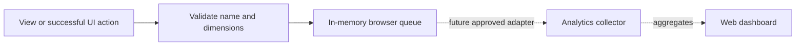

# Web analytics data layer

The application produces versioned events in `window.dataLayer`. The queue lives in the current document, preserves existing entries, and accepts up to 64 entries. A full queue or failing consumer leaves navigation and the interview usable. The producer never writes to storage or makes a network request.



## Event dictionary

Every event has `schema_version: 1`, an `event` string, and a `page_id` of `home` or `interview`.

| Event | Trigger | Dimensions |
| --- | --- | --- |
| `page_view` | Page script initializes | `page_id` |
| `interview_link_click` | Visitor activates a marked link on the profile | `page_id: home`, `placement: navigation / hero / portrait / project` |
| `interview_preview_open` | Visitor opens the preview | `page_id: interview` |
| `interview_preview_question_added` | Visitor adds a nonblank question | `page_id: interview` |
| `interview_preview_close` | Visitor closes the preview | `page_id: interview` |

```json
{
  "event": "interview_link_click",
  "schema_version": 1,
  "page_id": "home",
  "placement": "hero"
}
```

The schema excludes question text, URLs, referrers, cookies, storage IDs, user identifiers and timestamps. It measures document loads and actions. Subsequent history restores may reuse the same document. A click is an intent signal and may open in another tab or fail to reach the destination.

## Dashboard mapping

| Panel measure | Definition |
| --- | --- |
| Traffic by page | Count `page_view` by `page_id`. |
| Entry point engagement | Count `interview_link_click` by `placement`. |
| Preview opens per interview view | Opens divided by interview page views for the same reporting window. Repeat opens can raise this ratio above one. |
| Questions per preview open | Question-added events divided by preview opens. Repeat submissions contribute separately. |

Zero denominators should render as unavailable. These are aggregate counts and ratios. A per-person funnel, uniques, bounce rate and cross-page attribution need different data requirements.

A future approved adapter maps only listed events and dimensions, consumes queued events allowed by its consent policy, and observes subsequent pushes. It owns batching, transport, navigation delivery, storage and retention. Check provider auto-collection independently. Wire a synthetic receiver first and validate mapping, consent and filtering before enabling any dashboard collection. Sentry remains an independent error channel.

Behavior is versioned in the [OpenSpec web-analytics specification](../openspec/specs/web-analytics/spec.md).
