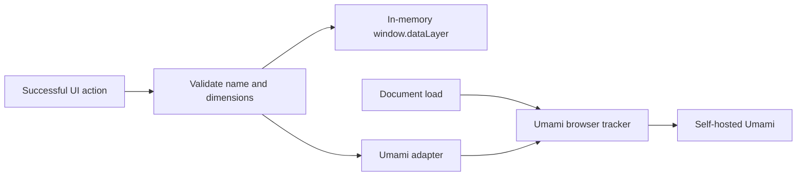

# Web analytics

The shared page head emits the self-hosted Umami tracker only for the manually triggered GitHub Actions release workflow on the production branch. Development, CI verification and preview builds omit the tracker by default. The tracker records page views on `cv.reflexionia.com`, as enforced by `data-domains`. The shared head also records `page_view` in the local versioned data layer and the adapter skips it to avoid a duplicate view in Umami.

The queue preserves existing entries with a limit of 64. The adapter dispatches approved events as they occur. It drops events while the collector is unavailable and leaves the visitor flow usable.

| Data layer event | Umami event | Custom data | Trigger |
| --- | --- | --- | --- |
| `page_view` | Automatic page view | — | A document loads. |
| `cv_download` | `cv-download` | `lang` (es or en) | An approved CV link with `data-analytics-action="cv-download"` is activated. Its `hreflang` takes precedence over the page language. |
| `linkedin_click` | `linkedin-click` | — | An approved link with `data-analytics-action="linkedin-click"` is activated. |
| `language_change` | `language-change` | `from`, `to` (es and en) | A link with `data-analytics-action="language-change"` switches between the document language and its `hreflang`. |
| `interview_link_click` | `interview-link-click` | `placement` (navigation, hero, portrait, project) | A profile link to the interview is activated. |
| `interview_preview_open` | `interview-open` | — | The visitor opens the interview preview. |
| `interview_preview_question_added` | `interview-question-sent` | — | A nonblank question is added to the local history. |
| `interview_preview_close` | `interview-close` | — | The visitor closes the preview. |
| `contact_click` | `contact-click` | — | An approved link with `data-analytics-action="contact-click"` is activated. |

The local envelope adds `schema_version: 1` and `page_id` (home or interview). Umami receives only the custom fields listed above and its standard page and browser metadata. The tracker omits URL queries, fragments and request credentials. The integration uses no tracking cookies or visitor IDs supplied by the application. The question, link destination and contact details are excluded from custom data.

Use page views by path, interview clicks by placement, preview opens per interview view, and submissions per open for aggregate reporting. Suppress ratios with a zero denominator. Clicks measure intent and repeated actions contribute to the counts.

## Verification and rollout

Local verification used a temporary static build allowing `127.0.0.1` and tagged `local-smoke`. The Umami dashboard recorded one visit, two page views and all eight custom event names. The CV, LinkedIn, language and contact controls were synthetic because the live routes currently lack those links and `/en/`. Reuse the shared head and the link attributes when those features are published.

Production verification requires an approved release. Check dashboard page views and exercise the published actions with `data-domains="cv.reflexionia.com"` intact. If a Content Security Policy is introduced, allow the Umami origin in `script-src` and `connect-src`. The integration uses the existing HTML and Astro assets accepted by the release receiver. The receiver allowlist will need an update when a release includes a new route or downloadable file outside the current allowlist.

See the [OpenSpec web analytics specification](../openspec/specs/web-analytics/spec.md).
