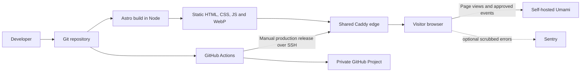
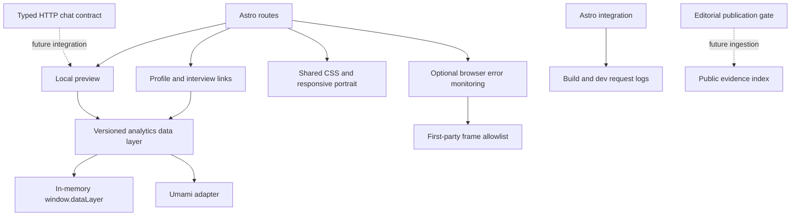
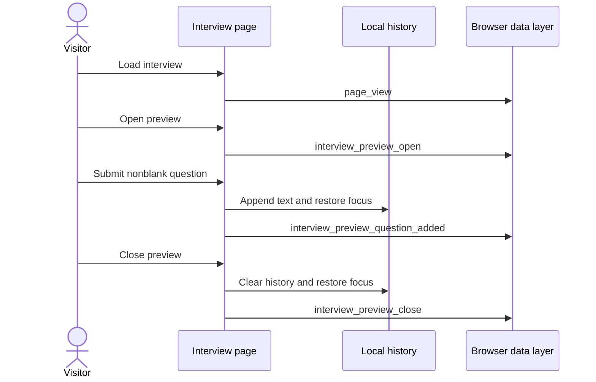
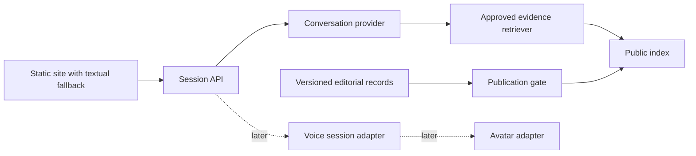

# Architecture

## System context

The build emits two HTML documents and hashed assets. Both pages work as documents before JavaScript runs. The interview uses progressive enhancement for a local history. The production target is the shared Caddy edge at `cv.reflexionia.com`. See the [deployment runbook](DEPLOYMENT.md) for provisioning and release activation.

The browser executes the preview and materializes analytics events. The build configures Umami for the production hostname. The dashed Sentry connection requires an explicit browser DSN.

## Component map

The editorial gate and the HTTP contract have implementation or type coverage in the repository. No current browser route imports the editorial gate or calls a chat API. See [module internals](MODULES.md).

## Functional flow

The question enters the DOM through `textContent`. The event queue receives the action name and a fixed page identifier. Closing the preview clears the DOM history. The event counts remain in memory until the document is discarded.

## Stack decisions

| Choice | Rationale and trade-off |
| --- | --- |
| Astro static output | Ships complete documents with scripts only where used. Live chat will need a separately deployed API. |
| TypeScript and native DOM APIs | Typed contracts and straightforward progressive enhancement without a UI runtime. Browser and Node verification catch different failure modes. |
| CSS and system fonts | Shared design and keyboard states with zero font requests. Typography follows the visitor's platform. |
| Astro image pipeline | Generates sized WebP derivatives and intrinsic dimensions from one source at build time. Updates to the portrait require a rebuild. |
| Node 22, npm and lockfile | Shared baseline for local work, Docker and CI. `npm ci` reproduces the dependency graph. |
| Docker Compose and worktrees | Isolated dependencies and parallel local branches with independent loopback ports. Static hosting remains independent of Docker. |
| GitHub Actions and Projects | Automated verification and PR-linked task tracking using an existing repository workflow. Project write permissions are confined to the merge workflow. |
| OpenSpec | Reviewable requirements and behavior changes alongside the commits that implement them. This documentation describes the running system. |
| Structured logs and optional Sentry | Local request and build correlation plus a separate browser error channel. The static host owns production access logging. |
| In-memory analytics data layer | A bounded versioned queue and an allowlisted adapter provide aggregate reporting without blocking visitor actions. |

## Target conversation architecture

The next milestone implements text first. The BFF owns origin and session validation, rate and cost limits, typed errors, and ephemeral session state. Retrieval uses approved public evidence. Responses cite the exact versions recovered or abstain. Sources are data and cannot grant instructions or permissions. Voice and avatar remain separate interfaces. See [the roadmap](BACKLOG.md) for sequencing.
