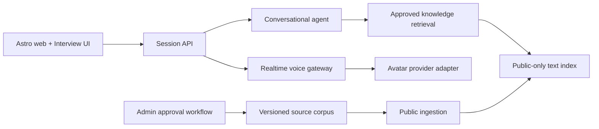

# Arquitectura objetivo

## Estado actual
Astro SSG. Dos páginas estáticas. Historial local y efímero de preguntas. La vista previa no hace peticiones de chat.

## Arquitectura futura

Interfaces a implementar:

- `KnowledgeRetriever.retrieve(query, locale): Evidence[]` — consulta exclusiva al índice editorial público.
- `ConversationProvider.reply(session, message, evidence): ChatReply`.
- `VoiceSessionProvider.start/stop/interrupt`.
- `AvatarProvider.start/stop/sendAudio`.
- `UsageLimiter.authorize/record/stop`.

## Endpoint targets (no implementados)

- `POST /api/v1/chat/sessions`
- `POST /api/v1/chat/sessions/{id}/messages`
- `DELETE /api/v1/chat/sessions/{id}`
- `POST /api/v1/realtime/sessions`
- `POST /api/v1/avatar/sessions`
- `DELETE /api/v1/avatar/sessions/{id}`
- `POST /api/v1/admin/knowledge/publish`

## Criterios no negociables

- El índice del agente público solo puede contener fragmentos aprobados y públicos.
- Abstenerse si un hecho profesional carece de evidencia.
- Los documentos recuperados son datos no instrucciones; proteger contra prompt injection.
- Grabaciones de terceros deshabilitadas por defecto. Micrófono solo tras gesto y permiso.
- Las credenciales efímeras se emiten por backend; nunca exponer claves de proveedores.
- Cuotas por sesión, presupuesto máximo y apagado del vídeo.
- Accesibilidad y fallback textual.

## Decisión de producto
El vídeo-avatar está desacoplado de la fuente de verdad. Se definirá tras prueba con vídeo/imagen propios; se puede seguir desarrollando usando la foto actual.

## Contrato de chat para el siguiente hito

- `POST /api/v1/chat/sessions` → 201 con `ChatSession`. Identificador opaco con expiración y sesión vinculada al navegador mediante cookie segura, HttpOnly y SameSite.
- `POST /api/v1/chat/sessions/{id}/messages` acepta `ChatQuestion` (texto de 1 a 500 caracteres tras recortar) y devuelve `ChatReply`. Una respuesta lleva citas del índice con identificador y versión. Una abstención explica que falta evidencia.
- `DELETE /api/v1/chat/sessions/{id}` → 204. Cierre idempotente para el propietario de la sesión, con liberación de estado efímero.
- Errores tipados en `src/data/chat-contract.ts`. Usar 400 para entrada inválida, 404 para sesión desconocida o no accesible, 429 para cuota y 503 para indisponibilidad. Validar origen y sesión antes de aceptar el mensaje. Limitar frecuencia y gasto en servidor y comprobar el interruptor de servicio antes de llamar al proveedor.
- Mantener el historial efímero. Evitar almacenar mensajes y excluirlos de logs por defecto. El fallback es el perfil estático.
- Empezar con un BFF TypeScript y búsqueda textual. El servidor valida que las citas de cada respuesta pertenecen a la evidencia autorizada recuperada. Si no hay evidencia suficiente, devuelve una abstención.
- El gate editorial implementado en `knowledge/publication.mjs` comprueba estado, visibilidad, versión aprobada y vigencia, y proyecta campos para el índice. El lector Markdown/YAML, la autenticación editorial, el indexado y el BFF aún están pendientes.
