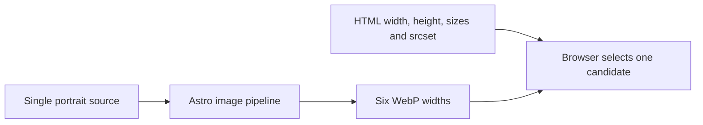

# Performance and accessibility

## Performance design

The build emits static HTML and hashed assets. Use system fonts, reserve image dimensions, prioritize the home portrait, and lazy-load the interview portrait. The analytics producer uses native browser APIs and a bounded queue. With Sentry disabled, the measured pages load only same-origin resources.

The original JPEG was 197,551 bytes. The largest generated candidate is 1200 px wide; a replacement source can keep the current aspect ratio at approximately 1200 × 1029 px. The generated WebP files span 6,002–42,300 bytes. At desktop and mobile widths the browser selects one candidate, not the entire set.

## Measured baseline

Lighthouse 13.6.0 used its default mobile profile against the static build on loopback with Sentry disabled. These are local lab results.

| Route | Performance | Accessibility | LCP | CLS | TBT |
| --- | ---: | ---: | ---: | ---: | ---: |
| Home | 100 | 100 | 1.20 s | 0 | 0 ms |
| Interview | 100 | 100 | 1.20 s | 0 | 0 ms |

Chrome requested 6,002 bytes for the home portrait at a 320 px viewport, 10,898 bytes at 390 px, and 24,146 bytes at 1440 px, at device scale factor 1. The uncompressed JavaScript asset bodies total about 0.86 KB on home and 2.06 KB on a fresh interview load. Navigating from home reuses the shared modules and adds about 1.20 KB. Inline scripts, if any, are part of the HTML and excluded from those asset totals. Production hosting and field Core Web Vitals remain unmeasured.

## Audit the right server

The default `docker compose up --build` serves a freshly built static preview on port 4321, with minified bundles and negotiated gzip for eligible responses. Tiny assets may be served without gzip. Run Lighthouse against that default in a clean Chrome profile. Development is opt-in through `npm run dev` or the [Compose development override](WORKFLOWS.md#local-development-and-worktrees). Its hot reload client and unminified modules belong to the development workflow.

Before the default switched to static preview, a Lighthouse 13.5.0 DevTools report targeted `/#experiencia` on port 4321. It recorded 58 for performance and 1,792 KiB of page transfers. The waterfall included Vite, Astro's toolbar modules and a browser extension. Lighthouse observed FCP at 0.27 s and LCP at 0.81 s, then estimated 7.4 s and 11.7 s under simulated mobile throttling.

A repeat on the same anchor with Lighthouse 13.6.0 mobile, a clean Chrome profile and Sentry disabled produced these lab measurements:

| Server | Performance | FCP | LCP | Page transfers |
| --- | ---: | ---: | ---: | ---: |
| Development, toolbar disabled | 100 | 0.83 s | 0.83 s | 352 KiB |
| Docker static preview | 100 | 0.77 s | 1.23 s | 26 KiB |

The waterfall confirmed zero toolbar requests in both runs. Only development requested the Vite client. Both rechecks scored 100 for accessibility and SEO, and 96 for best practices due to the browser's favicon request returning 404.

## Accessibility behavior

Both pages have semantic landmarks, a keyboard-visible skip link, visible focus styles and reduced-motion support. The interview labels its input and keeps the ordered history inside a live region, preserving list semantics. Opening the preview focuses the question field. Closing it clears the history and returns focus to the start button.

Chrome and axe checks passed on both routes at 320, 390 and 1440 px, including the open preview with a populated history. The browser check exercised Tab, Enter, focus restoration, reduced motion and horizontal reflow. [WCAG 2.2 AA](https://www.w3.org/TR/WCAG22/) is the target. Automated checks and keyboard testing are partial evidence, and no screen-reader conformance review has been completed.

## Repeat the checks

1. Run `npm run verify` and serve the static build with `npm run preview -- --host 127.0.0.1 --port 4387`. Use an empty Sentry DSN.
2. Audit both routes with Lighthouse mobile. Compare LCP, CLS and blocking time using the same browser and throttling profile. Inspect selected image and JavaScript bytes in the network panel.
3. Run axe with the preview closed and populated. Use keyboard-only navigation at 320 px and desktop widths. Check reduced motion, focus, list announcements and reflow. Recheck with a screen reader before public release.
4. Inspect `window.dataLayer` and the network panel after adding a synthetic question. Events should contain action metadata only, and analytics should cause no requests.
